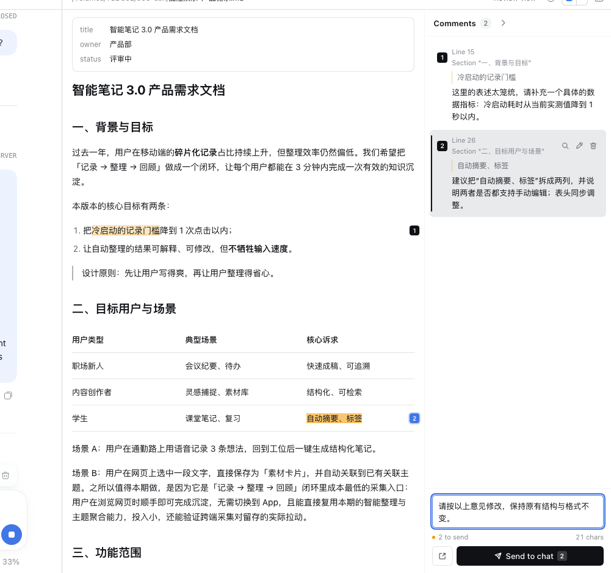
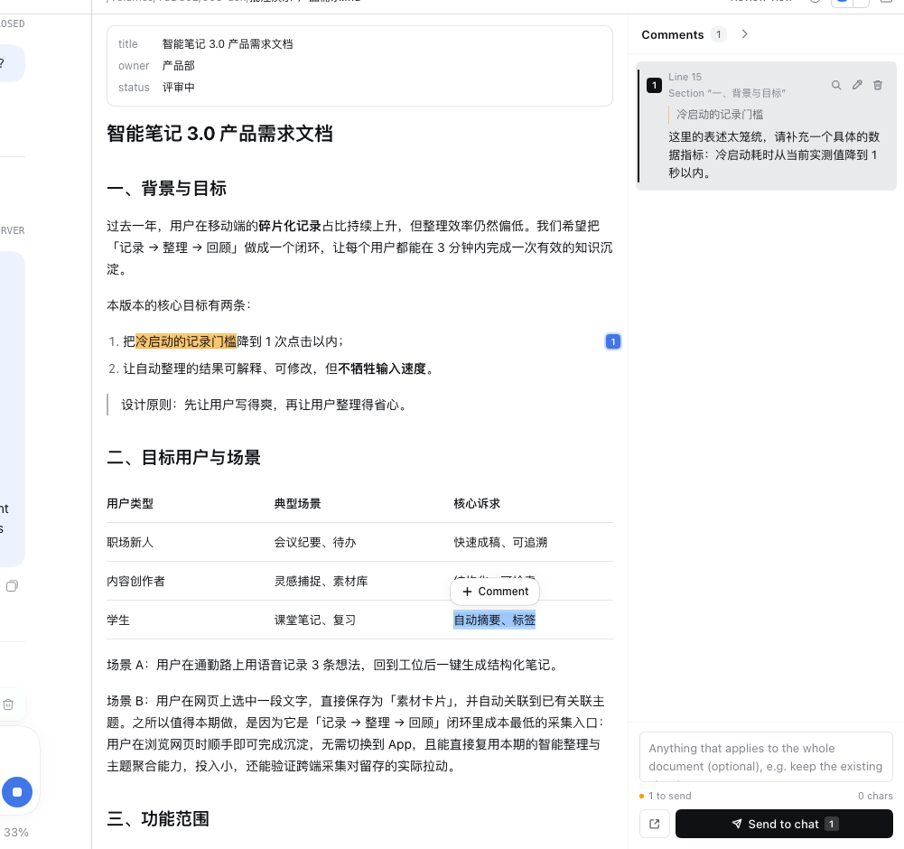
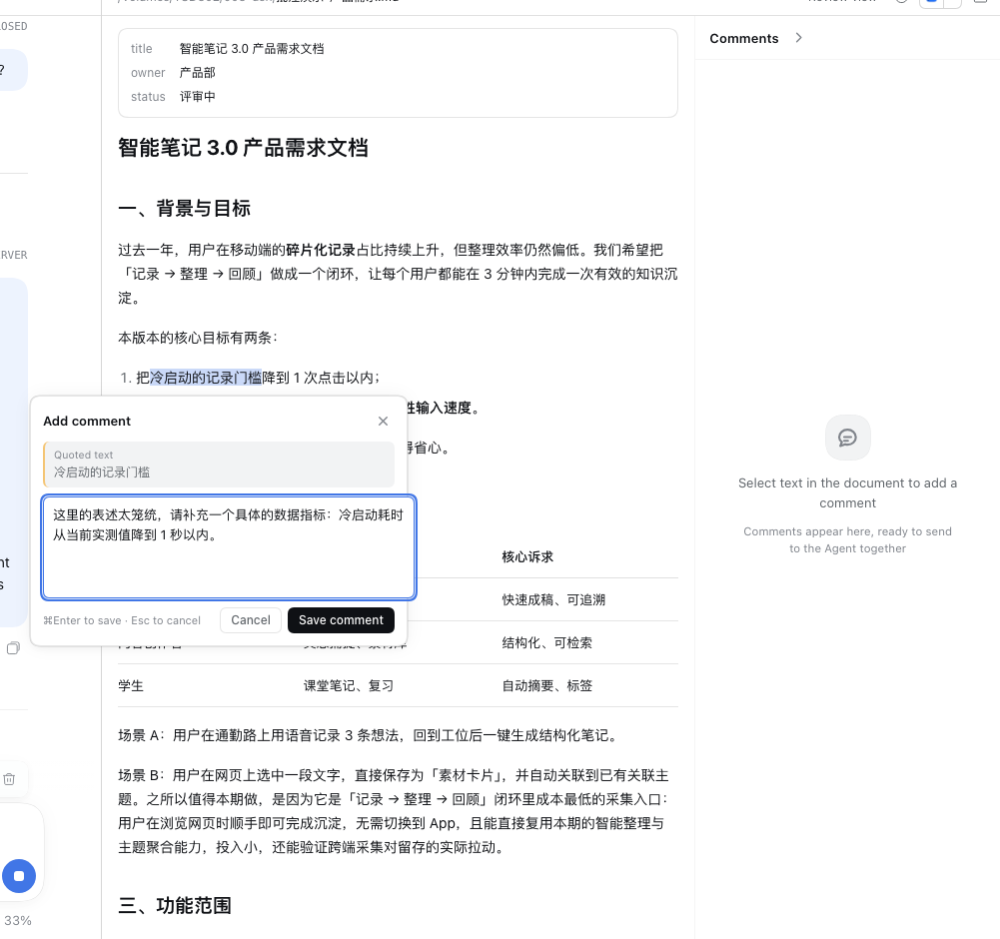
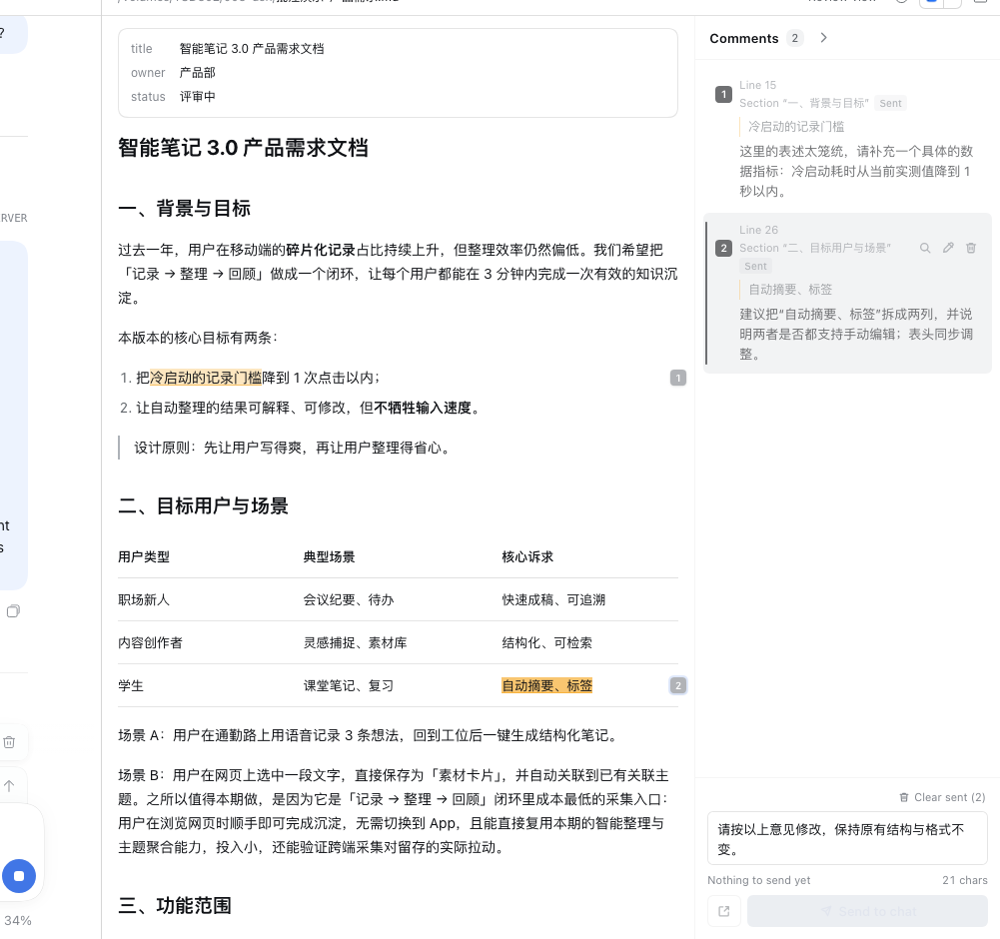

# dsh-md-review · 文档批注

> 在 DeepSeek Harness 右侧栏的 Markdown 预览里直接批注：选中一段文字 → 写下修改意见 → 文档里留下高亮和编号 → 最后一次性发给 Agent。

[](LICENSE)
[](https://github.com/topics/dsh-plugin)
[](https://github.com/Sara-Chen111/dsh-md-review/releases)



## 为什么做这个

和 Agent 协作写文档（PRD、调研、方案）时，审阅环节最麻烦的不是"看出问题"，而是"把问题说清楚"：
在预览里读到一段话，要复制原文、切到对话框、粘贴、写意见，再回到文档继续读。十几条意见下来，
复制粘贴和来回切换比思考还累。

这个插件把批注留在文档里：选中的原文有高亮和编号，意见排在右侧评论区，可以逐条检查、修改、
删除；全部记完后，底部写一句整体说明，点一次「发送到对话」，就把 n 条批注合并成一条结构化的
消息发给 Agent——带文件名、路径、行号、章节和原文引用，Agent 可以逐条处理。

## 功能

- **就地批注**：选中文档任意文字，点浮出的「添加批注」，不离开预览。
- **看得见**：已批注原文有琥珀色高亮，行尾有编号徽标；右侧批注栏列出全部意见卡片。
- **可检查**：点卡片可跳回原文；支持编辑、删除；发送后标记「已发送」，可一键清除。
- **统一发送**：底部输入整体说明，一键把所有未发送批注合并成一条消息发给 Agent；
  也可以「仅填入对话」，先在输入框里改一遍再发。
- **按文件保存**：批注存在浏览器 localStorage，刷新页面、重新打开文件都不丢；
  文件被 Agent 修改后按「引文 + 前后文」重新定位，行号和章节随之刷新，定位不到的会标记「原文已修改」。
- **不接管预览**：内置的 Markdown / Code / Plain text 查看器仍保留，可在预览右上角的「打开方式」里随时切回。

| 选中文字后的浮动按钮 | 批注编辑弹层 | 发送后的「已发送」状态 |
| --- | --- | --- |
|  |  |  |

## 安装

前置：DeepSeek Harness Desktop 或 `dsh web`（本插件在 `0.2.2-rc.1`，2026-11 验证）。
浏览器需支持 CSS Custom Highlight API（Chrome / Edge / Safari 17+）。

### 方式一：从 GitHub 安装（推荐）

在 DSH 的 **Plugins → Add plugin** 里粘贴：

```
github:Sara-Chen111/dsh-md-review
```

或在命令行执行：

```bash
dsh plugin add github:Sara-Chen111/dsh-md-review
```

### 方式二：克隆后本地安装

```bash
git clone https://github.com/Sara-Chen111/dsh-md-review.git
```

然后在 DSH 里用插件管理器安装该目录（或让 Agent 执行）：

```
plugin_manager action=install_bundle target=/absolute/path/to/dsh-md-review
```

安装完成后刷新 DSH Web 页面。右侧栏打开任意 `.md` 文件，默认就是「批注视图」（Review view）。

卸载：Plugins 页面移除该插件，或 `plugin_manager action=remove_bundle target=dsh-md-review`。

## 使用

1. 在右侧栏打开任意 `.md` 文件。
2. 在正文里选中一段文字 → 点击浮出的「添加批注」→ 写修改意见 → 保存（`⌘Enter`）。
3. 重复第 2 步，把所有意见记完；批注栏底部输入框可写整份文档的补充说明。
4. 点「发送到对话」：所有未发送批注合并成一条消息发到当前会话。
5. 发送后批注标记为「已发送」，可用「清除已发送」归档。

## 数据与边界

- 批注保存在当前浏览器的 localStorage，不跨设备同步；清除浏览器数据会丢失。
- 批注按「文件 + 会话」保存（预览的 resource address 含会话 id）：同一条会话里重新打开同一文件会恢复，
  换一条会话打开同一文件是独立的一份批注。
- 文件内容由预览的分页读取提供；超大文件需要滚动继续加载（与内置预览一致）。
- 发送依赖会话输入区的 `inputActions`（标准 slot props），只在右侧栏的文档预览内生效。
- Agent 修改文档后如果整段引文被删除，该批注会显示「原文已修改」，可以手动删除或重新引用。

## 开发

```bash
git clone https://github.com/Sara-Chen111/dsh-md-review.git
cd dsh-md-review
npm install --no-save --no-package-lock esbuild   # 仅构建需要
node build.mjs                                    # src/client/index.js -> client.js
node --test test/                                 # 52 个单元测试
```

- 浏览器端只有 `client.js` 一个产物（手写 `window.__ModuleLoader__.load` 包装 + esbuild CJS bundle），
  运行时只加载平台模块（`react`、`react/jsx-runtime` 等），不新增运行时依赖。
- `src/client/core/` 是纯逻辑（锚点、重定位、源码行号、消息拼装、DOM 高亮），`src/client/ui/` 是
  只看 props 的 React 组件，`src/client/review-body.jsx` 负责把两者接到预览 slot 上。
- 修改 `client.js` 后页面通过客户端 HMR 热更新，必要时刷新页面。

## 目录结构

```
dsh-md-review/
  package.json          # dsh.bundle + dsh.client 清单；locale/icon 元数据
  cordis.patch.yml      # 在 profile 里插入 host row
  index.js              # Host 半边（可选：写本地自动化验证用 token URL）
  build.mjs             # esbuild 打包脚本
  client.js             # 构建产物，唯一被浏览器加载的文件
  locale/               # Plugins 页面显示用的标题/描述（zh/en）
  icon.svg              # 插件图标
  src/client/           # 客户端源码（review-body / store / i18n / core / ui）
  test/                 # node:test 单元测试
  docs/                 # 截图与验证记录
```

## 验证

- `node --test test/`：52 passed（锚点/重定位/源码行号、消息格式、DOM 高亮、i18n 一致性）。
- 在运行中的 DSH Web GUI 里用 Playwright 跑过完整端到端流程：
  选中（含跨段落/整行表格）→ 浮动按钮 → 弹层保存 → 高亮/编号/卡片 → 编辑 → 删除 →
  刷新恢复 → 文件改动后行号自动刷新 → 仅填入对话 → 发送 → 已发送 → 清除已发送 →
  切换内置查看器再切回。详见 [docs/VERIFICATION.md](docs/VERIFICATION.md)。

## English summary

`dsh-md-review` adds a comment-review view to the DeepSeek Harness right-sidebar Markdown preview:
select text, leave review comments, see highlights with numbered pins, then send every pending comment
to the agent as one structured message (file, path, line, section and quoted text included). Comments
persist per file in localStorage and re-anchor when the agent edits the document. The built-in
Markdown / Code / Plain text viewers remain available.

Install: `dsh plugin add github:Sara-Chen111/dsh-md-review` (or paste the same spec in
Plugins → Add plugin), then open any `.md` file in the right sidebar.

## License

[MIT](LICENSE) © 2026 Sara Chen
